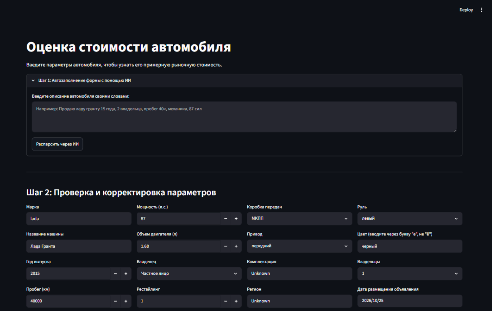
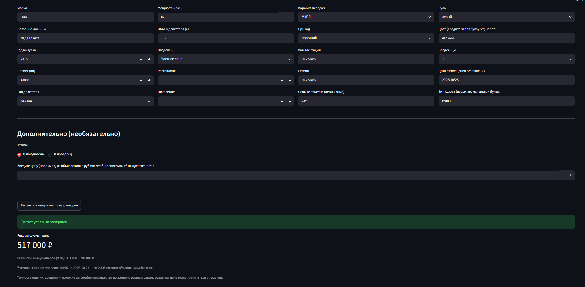
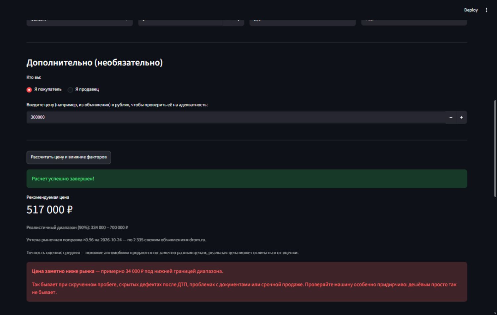
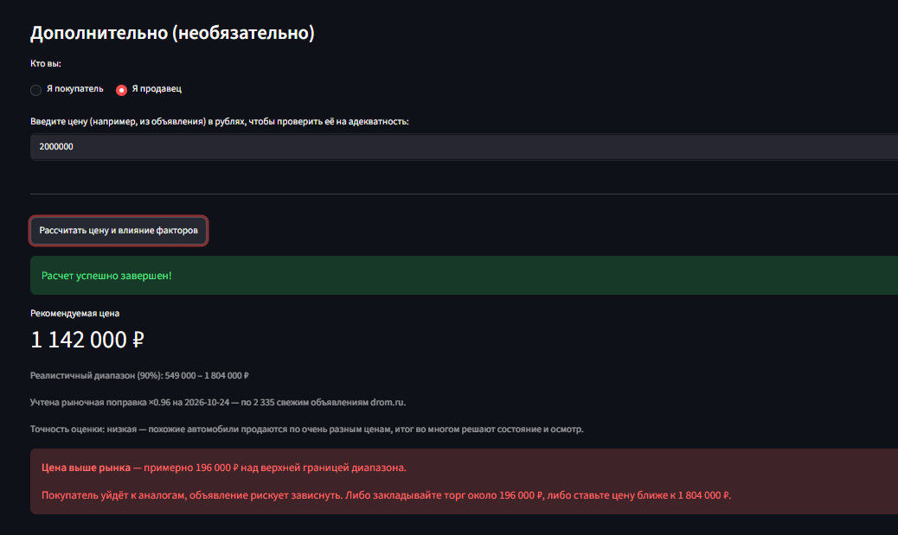
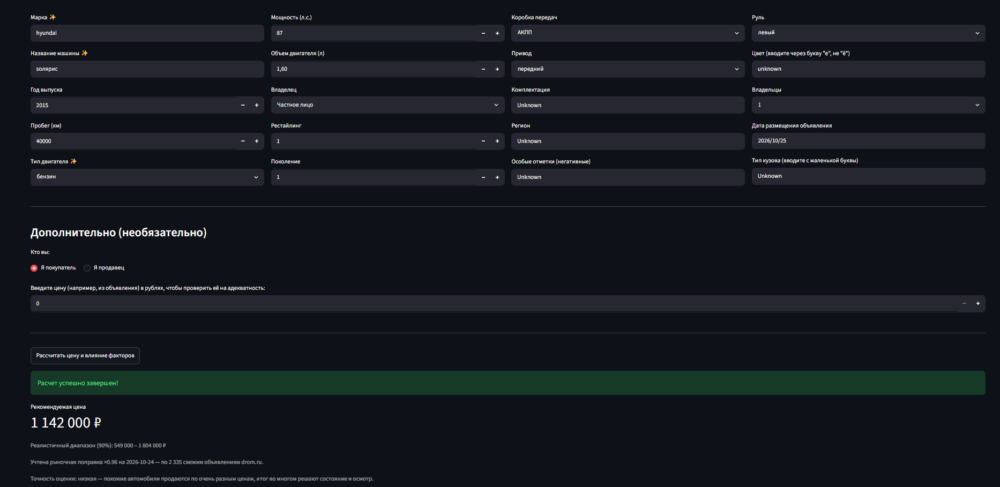
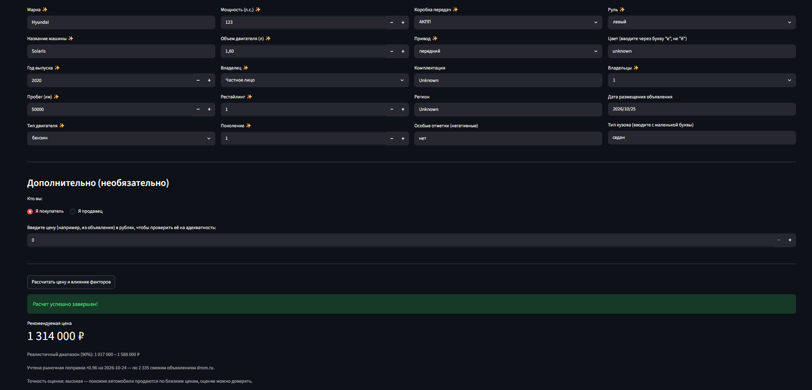
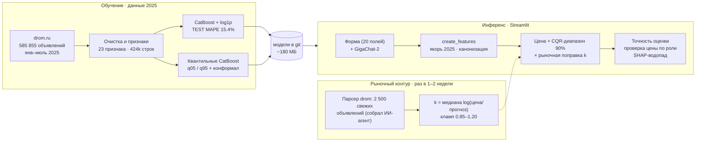

# 🚗 Car Price Analyzer


**Интерпретируемая система оценки рыночной стоимости автомобилей с конформальными интервалами и адаптацией к дрейфу рынка.**

Проект охватывает полный цикл: объявления drom.ru → очистка и исследование данных → CatBoost → интервалы CQR с честным покрытием 90 % → рыночная поправка по свежим объявлениям → Streamlit-приложение с ИИ-автозаполнением, проверкой цены для покупателя и продавца и SHAP-объяснением.

- **Данные:** 585 855 объявлений за январь–июль 2025 года.
- **Модель:** CatBoost + `TransformedTargetRegressor(log1p)`, 23 признака, TEST MAPE **15.40 %**.
- **Диапазон цен:** CQR (Conformalized Quantile Regression), измеренное покрытие **89.9 %**, адаптивная ширина.
- **Рыночная поправка:** ×0.96 по 2 335 свежим объявлениям drom.ru (октябрь 2026).
- **Интерфейс:** Streamlit, GigaChat-2, Plotly, SHAP.
- **Запуск:** локально на Python 3.11, в Docker или на VPS (см. [DEPLOY.md](DEPLOY.md)).

> 🌐 **Демо-стенд:** `http://<не запущен>`

---

## ✨ Возможности

- **🤖 Автозаполнение формы через ИИ** — опишите автомобиль своими словами, и GigaChat-2 извлечёт параметры в структурированный JSON. Заполненные ИИ поля помечаются ✨.
- **📈 Цена и честный диапазон** — точечная оценка CatBoost плюс интервал с покрытием 90 %, построенный двумя квантильными моделями с конформальной калибровкой (CQR).
- **🎯 Точность оценки** — подпись простым языком объясняет, насколько уверенно модель оценивает именно эту машину: похожие автомобили продаются по близким или очень разным ценам.
- **⚖️ Роли покупатель / продавец** — одна и та же цена ниже или выше рынка означает разное: покупателю — про проверку пробега и дефектов, продавцу — про недополученные рубли и зависшие объявления.
- **🔁 Рыночная поправка** — модель обучена на уровне 2025 года; поправочный коэффициент по свежим объявлениям drom.ru переносит оценку на сегодняшнее состояние рынка.
- **🔤 Канонизация ввода** — «Toyota», «лада гранта» и «москва» автоматически приводятся к категориям обучающих данных; CatBoost чувствителен к регистру, и без этого прогноз бы искажался.
- **📊 SHAP-интерпретация** — waterfall по группам факторов с пересчётом вкладов в рубли.
- **⚠️ Предупреждения о границах применимости** — год выпуска ограничен 2025-м (в обучении нет машин 2026 года), отдельные предупреждения для авто старше 1990 года и прогнозов ниже 150 000 ₽.
- **🐳 Docker** — образ содержит приложение и все артефакты инференса; данные и ноутбуки не нужны.

---

## 🖥️ Интерфейс

### Форма с дефолтами



Дефолтная машина в форме — реальная, часто встречающаяся в обучающих данных конфигурация (Гранта 2015, 87 л.с., МКПП, 1-е поколение): редкие и несуществующие сочетания параметров честно расширяют интервал неопределённости, поэтому пример в форме не должен быть «химерой».

### Результат расчёта



### Проверка цены: две роли





### Реакция на несуществующую конфигурацию

Слева — Солярис 2020 «с мотором Гранты» (87 л.с., 1-е поколение: в обучении таких нет), справа — реальный (123 л.с., 2-е поколение). Химерная конфигурация получает более широкую вилку и пониженную точность — система сама сигнализирует, что введённые параметры стоит перепроверить:

| Конфигурация | Цена | Диапазон 90 % | Точность |
|---|---|---|---|
| «Солярис 2020, 87 л.с., 1 поколение» | 1 074 000 ₽ | 778 000 – 1 272 000 | средняя |
| **Солярис 2020, 123 л.с., 2 поколение** | **1 415 000 ₽** | **1 138 000 – 1 670 000** | **высокая** |





### SHAP-разбор и предупреждения


---

## 🏗️ Архитектура



**Ключевые модули:**

| Модуль | Назначение |
|--------|-----------|
| `app.py` | Streamlit-интерфейс: форма, ИИ-парсинг, роли, проверка цены, SHAP |
| `src/predict.py` | Точечная цена, CQR-интервал, рыночная поправка |
| `src/feature_eng.py` | Признаки из полей формы: якорь 2025, канонизация категорий |
| `src/shap_utils.py` | SHAP-значения и перевод вкладов из логарифмов в рубли |
| `src/llm_parser.py` | Извлечение параметров автомобиля из текста через GigaChat-2 |
| `models/04_interval.py` | Обучение квантильных моделей и конформальная калибровка (CQR) |
| `scripts/market_coefficient.py` | Пересчёт рыночной поправки по свежему парсингу drom |
| `scripts/build_category_vocab.py` | Пересборка словаря канонизации категорий |
| `tests/test_smoke.py` | Smoke-тесты: признаки, предсказание, математика поправки |

---

## 📁 Структура проекта

```text
car-price-analyzer/
├── app.py                         # Streamlit-приложение
├── requirements.txt               # Зависимости
├── Dockerfile / .dockerignore     # Docker-образ
├── DEPLOY.md                      # Гайд по деплою на VPS
├── .streamlit/
│   └── secrets.toml.example       # Шаблон ключа GigaChat
├── src/
│   ├── predict.py                 # Цена, CQR-интервал, рыночная поправка
│   ├── feature_eng.py             # Признаки, якорь 2025, канонизация
│   ├── shap_utils.py              # SHAP в рублях
│   └── llm_parser.py              # GigaChat-парсер
├── models/
│   ├── best_catboost_model.pkl    # Основная модель (~80 МБ, в git)
│   ├── cqr_models.pkl             # Квантильные модели + delta (CQR, ~67 МБ, в git)
│   ├── category_vocab.json        # Словарь канонизации категорий
│   ├── market_coefficient.json    # Текущий рыночный коэффициент
│   └── 01–04_*.py                 # Скрипты обучения (история + воспроизводимость)
├── scripts/
│   ├── market_coefficient.py      # Пересчёт рыночной поправки
│   └── build_category_vocab.py    # Пересборка словаря категорий
├── notebooks/                     # Очистка, EDA, финальное обучение
├── researches/                    # Сравнение датасетов, ICE/PDP, SHAP, ошибки
├── tests/test_smoke.py
├── images/                        # Скриншоты для README
├── data/                          # Локальные данные (в git отсутствуют)
└── README.md
```

Все артефакты, нужные для инференса (модели, словарь категорий, файл коэффициента), хранятся в git — свежий клон запускается сразу, без исходных данных.

---

## 🚀 Запуск

### Требования

- **Python 3.11** — версия Docker-образа; другие не проверялись.
- Ключ GigaChat — только для автозаполнения; прогноз, интервалы, поправка и тесты работают без него.
- Исходные данные не нужны: всё для инференса уже в репозитории.

### Локально

**Windows (PowerShell):**

```powershell
git clone https://github.com/deviloon/car-price-analyzer.git
cd car-price-analyzer

py -3.11 -m venv .venv
.\.venv\Scripts\Activate.ps1

python -m pip install --upgrade pip
pip install -r requirements.txt

python -m streamlit run app.py
```

**Linux / macOS:**

```bash
git clone https://github.com/deviloon/car-price-analyzer.git
cd car-price-analyzer

python3.11 -m venv .venv
source .venv/bin/activate

python -m pip install --upgrade pip
pip install -r requirements.txt

python -m streamlit run app.py
```

На Debian/Ubuntu для CatBoost может понадобиться `sudo apt-get install -y libgomp1`. Приложение откроется на `http://localhost:8501`.

### Ключ GigaChat (необязательно)

Скопируйте `.streamlit/secrets.toml.example` в `.streamlit/secrets.toml` и впишите `GIGACHAT_CREDENTIALS = "<ключ>"`, либо задайте переменную окружения `GIGACHAT_CREDENTIALS`. Используются модель `GigaChat-2` и scope `GIGACHAT_API_PERS`. Реальные ключи не коммитьте.

### Docker

```bash
docker build -t car-price-analyzer .
docker run --rm -p 8501:8501 car-price-analyzer
curl http://localhost:8501/_stcore/health   # ok
```

Ключ GigaChat — через `--env-file .env`. Полный гайд деплоя на VPS — в [DEPLOY.md](DEPLOY.md).

### Тесты

```bash
python -m unittest tests.test_smoke -v
```

Два теста: признаки (якорь 2025, формат поколений, канонизация «Модели») и математика рыночной поправки. Не требуют сети и данных, 2–10 секунд.

---

## 🎯 Как пользоваться

1. Опишите автомобиль своими словами и нажмите **«Распарсить через ИИ»** — или заполните форму вручную.
2. Проверьте поля (отмеченные ✨ — особенно: мощность, поколение, коробка — несуществующие сочетания расширяют интервал).
3. Выберите роль — **«Я покупатель»** или **«Я продавец»** — и при желании введите цену из объявления.
4. Нажмите **«Рассчитать цену и влияние факторов»**: цена, диапазон 90 %, точность оценки, проверка цены с советами по вашей роли и SHAP-разбор.

---

## 💰 Как считаются цена и диапазон

### Точечная цена

CatBoost (MAE-лосс на `log1p(цена)`). 20 полей формы превращаются в 23 признака. Прогноз — уровень рынка **середины 2025 года**.

### Якорь 2025 и дата

Модель обучена только на объявлениях января–июля 2025 года, поэтому в признак «Год размещения» всегда подставляется якорное значение 2025 — независимо от даты в форме. Дата останется в интерфейсе для удобства, но модель её не видит: сдвиг рынка во времени закрывает рыночная поправка, а не признаки. По той же причине **автомобили 2026 модельного года не оцениваются** — их нет в обучающих данных, и ограничение года в форме (`max 2025`) честнее, чем молчаливая экстраполяция.

### Диапазон 90 % (CQR)

Диапазон строится **двумя дополнительными CatBoost-моделями** — квантильными (5-й и 95-й перцентили логарифма цены), — а затем калибруется конформальной поправкой `delta` на отдельной выборке (метод CQR, Romano et al., 2019). Это даёт измеренное на отложенных данных покрытие **89.9 %** (цель 90 %).

Почему не «± MAPE»? У эвристических границ `price × [1 − 2×MAPE; 1 + MAPE]` фактическое покрытие было всего **76.5 %** — каждое четвёртое объявление выпадало из «диапазона». MAPE — средняя ошибка, а не граница, и интервалом не является.

Ширина интервала **адаптивная**: частым и предсказуемым конфигурациям соответствует узкая вилка (10 % машин — шириной до 40 % цены, медиана — 62 %), редким и «химерным» — широкая (10 % машин — шире 112 %). Именно из этой ширины рождается подпись «Точность оценки».

Числа верифицированы на 106 тысячах отложенных объявлений: покрытие 89.88 %, пересечение квантилей — 1 машина из 106 038, точечный прогноз вне своей вилки — 0.04 %.

### Точность оценки

Подпись считается по относительной ширине интервала `(верхняя − нижняя) / цена`:

| Ширина | Подпись | Что это значит |
|---|---|---|
| < 45 % | высокая | похожие автомобили продаются по близким ценам, оценке можно доверять |
| 45–85 % | средняя | похожие автомобили продаются по заметно разным ценам |
| > 85 % | низкая | аналоги продаются по очень разным ценам, итог решают состояние и осмотр |

Пороги выбраны по распределению ширины на тесте (p10 = 40 %, медиана = 62 %, p90 = 112 %).

### Предупреждение о ценах ниже 150 000 ₽

Минимальная цена в обучающих данных — 150 000 ₽. Прогноз ниже этой границы означает экстраполяцию, и интерфейс честно об этом предупреждает.

---

## 🔁 Рыночная поправка

Модель — фотография рынка середины 2025 года. Чтобы оценка отвечала на вопрос «сколько стоит **сейчас**», прогноз и границы интервала домножаются на рыночный коэффициент **k**.

**Как считается.** Свежие объявления drom.ru (выгрузка парсером — 2 500 штук, стратифицированных по ценовым корзинам; парсер собран ИИ-агентом) прогоняются через модель с якорем 2025, затем берётся медиана логарифма отношения «фактическая цена / прогноз»:

```text
k = exp( median( log(цена / прогноз_с_якорем_2025) ) ) = 0.960
```

(95 % доверительный интервал бутстрепом: 0.953–0.969, n = 2 335 после фильтров).

**Почему k меньше единицы — не ошибка.** Средняя цена автомобиля на рынке за год выросла (~+3.5 %), но это **эффект состава**: поток продаж сместился к более новым и дорогим машинам. Дрейф же измеряется **для одной и той же машины** (like-for-like): сопоставимые автомобили к октябрю 2026 стоят на ~4 % дешевле уровня середины 2025. Оба факта верны одновременно; метод проверен и безмодельным сравнением — медианные цены ячеек «модель + год + пробег» в обучении против свежих объявлений дают ту же картину (−9 % в лог-шкале без учёта признаков).

**Безопасность.** k ограничен клампом [0.85; 1.20]: выход за границы — не «домножай сильнее», а сигнал, что рынок уехал слишком далеко и модель пора переобучать. Пересчёт — раз в 1–2 недели командой `py scripts/market_coefficient.py`; история сохраняется в `data/market_history.jsonl` и со временем превращается в собственный индекс рынка.

Известное ограничение: k единый для всего рынка, тогда как дрейф по сегментам разный (дешёвые автомобили за год подешевели сильнее дорогих). Это осознанный компромисс в пользу простоты и объяснимости.

---

## 🔤 Канонизация ввода

CatBoost сравнивает категории буквально, а обучающие данные записаны в своём формате: марки строчными латиницей (`toyota`), модели с заглавной (`Гранта`, `Camry`), регионы как в объявлениях (`Москва`). Поэтому «Toyota», «лада гранта» или «СЕДАН» из формы сначала приводятся к каноническому виду по словарю `models/category_vocab.json` (нормализация регистра, «ё»→«е», пробелы + алиасы марок). Без этого несуществующая категория тихо искажала прогноз: например, «lada granta» в поле названия стоило Гранте +27 % к цене и +59 п.п. к ширине интервала.

---

## 📊 Данные

- **Источник:** объявления о продаже подержанных автомобилей с drom.ru.
- **Период:** 14 января — 14 июля 2025 года; 585 855 строк, 58 исходных колонок.
- **Целевая переменная:** `Цена`, рубли; фильтр `Цена ≥ 150 000 ₽`.
- Версии датасета (`raw` → `cleaned` → `features` → `optimized`) и путь экспериментов описаны в ноутбуках `notebooks/` и `researches/`; в финальную модель пошёл `optimized` — минимальная очистка и нативные категории CatBoost оказались лучше агрессивной чистки.

Исходный CSV (~5.4 ГБ) в репозиторий не входит; для обучения положите его в `data/raw/raw_dataset.csv`. Для инференса данные не нужны.

---

## 🧠 Как устроена модель

### Основная модель

`CatBoostRegressor` (2500 итераций, depth 10, MAE-лосс, seed 42) внутри `TransformedTargetRegressor(log1p)`. 23 признака: 13 категориальных, 2 текстовых (`Комплектация`, `Особые отметки`), 8 числовых. Обучение на GPU, инференс на CPU. MAE на логарифмах приближает относительную ошибку — поэтому loss MAE при метрике MAPE.

### Интервальные модели (CQR)

Две CatBoost с `Quantile:alpha=0.05/0.95` (1200 итераций, depth 6) на `log(цена)`, обученные в `models/04_interval.py` на 80 % трейна; на оставшихся 20 % (калибровка) считается конформальная поправка `delta = квантиль(max(q05 − y, y − q95), 0.9)` с конечной поправкой `ceil((n+1)·0.9)/n`. Бандл `{model_low, model_high, delta}` хранится в `models/cqr_models.pkl`; покрытие зафиксировано на 90 %.

### Рыночная поправка

`models/market_coefficient.json` (k, дата, размер выборки, ДИ, флаг клампа) применяется ко всем трём числам — цене и обеим границам; нижняя граница округляется вниз, верхняя — вверх, чтобы округление не сужало обещанный интервал.

---

## 📈 Результаты

### Точность

| Метрика | Значение |
|---------|----------|
| CV MAPE (5-fold) | 15.55 % |
| **TEST MAPE** | **15.40 %** |
| **TEST MAE** | **142 920 ₽** |
| MAPE на авто < 300 тыс. ₽ | 23.68 % |
| MAPE на остальных | 13.79 % |

### Интервалы (CQR, тест 106 038 объявлений)

| Метрика | Значение |
|---------|----------|
| Покрытие (цель 90 %) | **89.88 %** |
| Медианная относительная ширина | 62.4 % (p10 = 40 %, p90 = 112 %) |
| Покрытие по сегментам | < 300к: 88.9 % · 300к–1М: 91.0 % · 1–3М: 89.2 % · 3М+: 86.9 % |
| Для сравнения: старые границы ±MAPE | покрытие 76.5 % |

Сегментные покрытия показывают честную картину: конформальная гарантия — общая (маржинальная), условное покрытие по подгруппам может отклоняться.

### Сравнение датасетов и исторические эксперименты

<details>
<summary><b>Развернуть</b></summary>

Одна и та же CatBoost-конфигурация на разных версиях датасета (`researches/01`):

| Датасет | CV MAPE | TEST MAPE | TEST MAE |
|---------|---------|-----------|----------|
| `raw` | 15.69 % | 15.48 % | 121 015 ₽ |
| `cleaned` | 18.05 % | 18.36 % | 139 507 ₽ |
| `features` | 18.08 % | 18.44 % | 141 096 ₽ |
| **`optimized`** | **15.45 %** | **15.29 %** | **139 173 ₽** |

Бейзлайны на `features`: LightGBM 17.85/18.65, XGBoost 17.96/18.52, CatBoost 18.08/18.43, Ridge 25.06/26.39 (CV/TEST MAPE, %). Сравнение HPO: Optuna ≈ RandomSearch при в разы меньшем времени. Подробности — в `researches/` и истории коммитов `models/01–03`.

</details>

---

## 🔬 Интерпретируемость

SHAP-водопад в приложении группирует вклады по категориям факторов (износ, двигатель, история, бренд, кузов, география) и пересчитывает их в рубли. Главные драйверы цены — комплектация, год, мощность, объём и пробег. PDP/ICE-анализ (`researches/02`) подтверждает sane-направления зависимостей: новее — дороже, больше пробег — дешевле, мощность растёт до ~150 л.с.

> SHAP-вклады — условные объяснения модели на конкретных данных, а не причинные эффекты.

---

## ⚠️ Ограничения

- Модель обучена на объявлениях января–июля 2025 года; рыночная поправка компенсирует дрейф среднего уровня, но не изменение структуры рынка.
- Единый коэффициент k при неоднородном дрейфе сегментов: дешёвые автомобили за год дешевеют сильнее дорогих, поправка усредняет.
- Используются цены предложения, а не сделок; свежие объявления могут быть с «наивным» торгом.
- Условное покрытие интервалов по подгруппам может отклоняться от 90 % (гарантия — общая).
- Нет признаков реального состояния, истории обслуживания и юридической чистоты; год и пробег — прокси износа.
- Один случайный train/test split; внешней валидации, кроме рыночного контура, не проводилось.
- GigaChat может ошибаться в извлечении параметров; поля нужно проверять — «точность оценки» помогает ловить подозрительные конфигурации.
- Прогноз — ориентир, а не замена осмотру, диагностике и юридической проверке.

---

## 🔁 Обучение с нуля

1. Положите `data/raw/raw_dataset.csv` (структура папок — как в таблице ниже) и запустите ноутбуки по порядку:

| Ноутбук | Вход | Выход |
|---------|------|-------|
| `01_data_cleaning.ipynb` | `data/raw/raw_dataset.csv` | `df_optimal.parquet`, `data/cleaned/*` |
| `02_eda_and_features.ipynb` | `data/cleaned/*` | `data/features/*` (эксперимент) |
| `03_final_catboost_optimized.ipynb` | `df_optimal.parquet` | `models/best_catboost_model.pkl`, `data/optimized/*` |

2. Интервалы: `py models/04_interval.py` (CPU, ~20 минут) → пересоздаст `models/cqr_models.pkl`.
3. Словарь категорий: `py scripts/build_category_vocab.py` → `models/category_vocab.json`.
4. Рыночная поправка: положите свежий парсинг в `data/market/listings_ГГГГ-ММ-ДД.json` и запустите `py scripts/market_coefficient.py`.

Обучение основной модели требует GPU (`task_type='GPU'`; для CPU замените — будет медленнее). `shap` нужен только исследованиям: `pip install shap`.

---

## 🛠️ Технологический стек

| Сфера | Инструменты |
|-------|-------------|
| Данные | pandas, NumPy, pyarrow, Phik |
| ML | CatBoost, XGBoost, LightGBM, scikit-learn |
| HPO и эксперименты | Optuna, MLflow |
| Интервалы | CQR (квантильный loss CatBoost + конформальная калибровка) |
| Интерпретация | SHAP, PDP/ICE |
| Веб | Streamlit, Plotly |
| LLM | GigaChat-2 / `gigachat` SDK |
| Инфраструктура | Docker (Python 3.11-slim), Git |
| Тесты | `unittest` |

---

## 🔐 Секреты

- В репозитории только `.streamlit/secrets.toml.example` с заглушкой.
- Реальные ключи — в `.streamlit/secrets.toml` или переменной `GIGACHAT_CREDENTIALS`; оба пути вне git.
- Для Docker предпочтителен `--env-file .env`.
- Утёкший ключ отзовите в GigaChat и выпустите новый.

---

## 🗺️ Roadmap

- [ ] Повторный парсинг тех же объявлений по `listing_id` — прямой мониторинг снижения цен и динамика k во времени (история уже пишется).
- [ ] Сегментные модели или плавная поправка k (цена) вместо единого коэффициента.
- [ ] Переобучение модели на свежих данных при выходе k за кламп [0.85; 1.20].
- [ ] БД исправлений GigaChat-автозаполнения пользователями: где ИИ ошибается чаще всего → дообучение парсера.
- [ ] Подсказка (не предупреждение) в форме, если конфигурации нет в словаре обучения.
- [ ] Справочник автозаполнения пропущенных характеристик (например, мощности по модели и году).
- [ ] REST API (FastAPI) поверх инференса.
- [ ] Телеграм-бот.
- [ ] CI с автозапуском тестов; batch-режим оценки выгрузок.

---

## 📄 Лицензия

Проект распространяется под лицензией **MIT**. Подробнее — в файле [LICENSE](LICENSE).

Copyright (c) 2026 deviloon.

---

## 🧑‍💻 Автор

Учебный проект: полный ML-пайплайн, честные интервалы неопределённости, мониторинг дрейфа рынка, LLM-интеграция и веб-интерфейс.