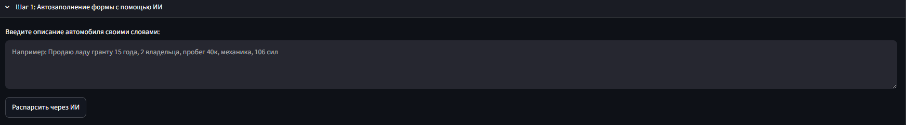
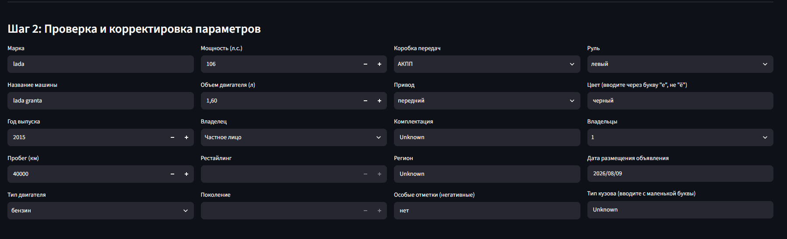
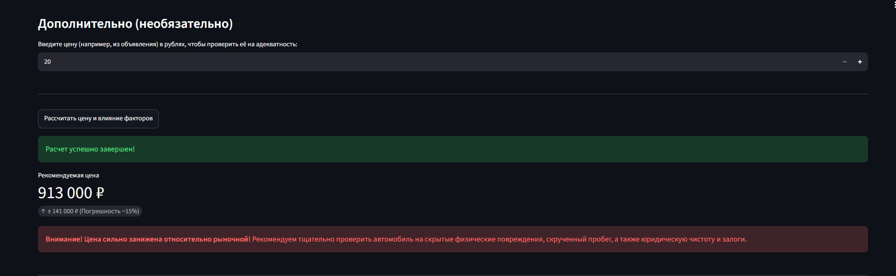
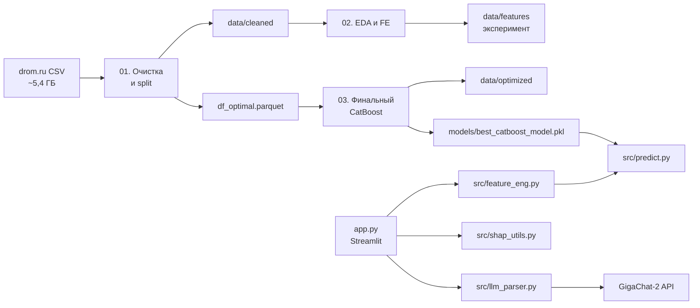
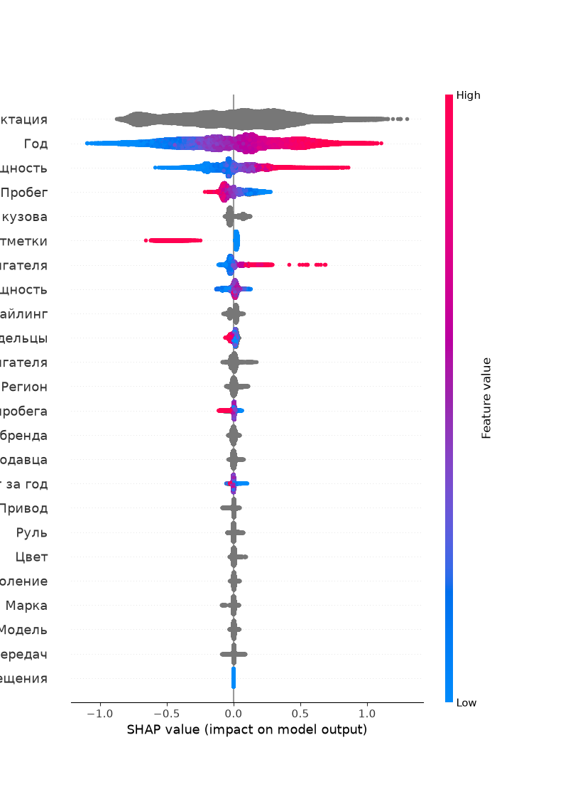
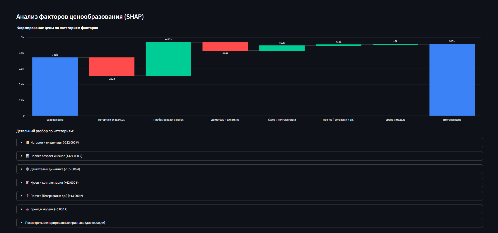
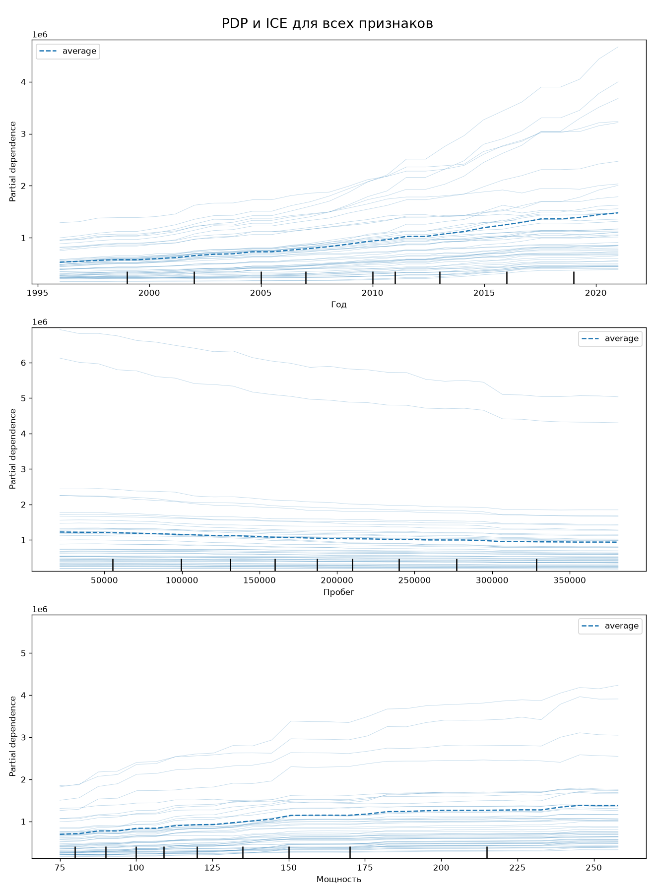

# 🚗 Car Price Analyzer


**Сервис оценки рыночной стоимости подержанных автомобилей на основе машинного обучения.**

Проект охватывает полный цикл: объявления drom.ru → очистка и исследование данных → CatBoost → Streamlit-приложение с необязательным ИИ-автозаполнением и SHAP-объяснением цены.

- **Данные:** 585 855 объявлений за январь–июль 2025 года.
- **Модель:** CatBoost + `TransformedTargetRegressor(log1p)`, 23 признака.
- **Качество:** TEST MAPE **15.40 %**, MAE **142 920 ₽** на отложенной выборке.
- **Интерфейс:** Streamlit, GigaChat-2, Plotly, SHAP.
- **Запуск:** локально на Python 3.11 или в Docker.

> Публичный демо-стенд сейчас не поддерживается. Актуальный способ запуска — локально или через Docker (см. раздел [«Запуск»](#-запуск)).

---

## ✨ Возможности

- **🤖 Автозаполнение формы через ИИ** — опишите автомобиль своими словами, и GigaChat-2 извлечёт параметры в структурированный JSON. Поля, которые заполнил ИИ, отмечаются значком ✨.
- **📈 Прогноз цены** — CatBoost, обученный на оптимизированном датасете, оценивает стоимость по 20 полям формы, которые превращаются в 23 признака модели.
- **🔍 Проверка цены объявления** — приложение предупреждает, если введённая цена ниже или выше рассчитанного диапазона.
- **📊 SHAP-интерпретация** — интерактивный waterfall по категориям факторов: пробег и износ, двигатель, история, бренд, кузов, география. Вклады пересчитываются в рубли.
- **⚠️ Предупреждения о границах применимости** — для автомобилей старше 1990 года и пробега больше 999 999 км интерфейс предупреждает о менее надёжном прогнозе.
- **🐳 Docker** — образ содержит приложение и модель; данные и ноутбуки для инференса не нужны.

---

## 🖥️ Интерфейс

### Шаг 1. Свободное описание и ИИ-парсинг



### Шаг 2. Проверка и ручная корректировка



### Результат расчёта



Интерфейс состоит из двух шагов и необязательного блока проверки цены:

| Шаг | Что происходит |
|-----|----------------|
| **1. Автозаполнение** | Пользователь пишет описание → GigaChat извлекает параметры → форма заполняется |
| **2. Проверка и расчёт** | Пользователь исправляет поля → «Рассчитать цену и влияние факторов» → цена, проверка объявления и SHAP |

После расчёта показываются рекомендованная цена, верхняя поправка к ней (в рублях и процентах MAPE), предупреждение о заниженной или завышенной цене, waterfall по группам факторов, детальный разбор признаков и отладочная таблица сгенерированных признаков.

> ИИ-парсер только ускоряет ввод. Приложение полностью работает и без ключа GigaChat — форму можно заполнить вручную.

---

## 🏗️ Архитектура



Ноутбук `03` — основной финальный пайплайн. Ветка `02` с `features`-датасетом использовалась для исследования и экспериментов; в продакшн-модель она не попала.

**Ключевые модули:**

| Модуль | Назначение |
|--------|-----------|
| `app.py` | Streamlit-интерфейс: форма, ИИ-парсинг, проверка цены, SHAP-визуализация |
| `src/predict.py` | Загрузка модели, предсказание цены и расчёт диапазона |
| `src/feature_eng.py` | Генерация признаков из полей формы при инференсе |
| `src/shap_utils.py` | SHAP-значения и перевод вкладов из логарифмов в рубли |
| `src/llm_parser.py` | Извлечение параметров автомобиля из текста через GigaChat-2 |
| `tests/test_smoke.py` | Быстрый smoke-тест загрузки модели и предсказания |

---

## 📁 Структура проекта

```text
car-price-analyzer/
├── app.py                         # Streamlit-приложение
├── requirements.txt               # Зависимости
├── Dockerfile                     # Docker-образ для запуска приложения
├── .streamlit/
│   └── secrets.toml.example       # Шаблон ключа; secrets.toml в .gitignore
├── src/
│   ├── predict.py                 # Инференс и диапазон цены
│   ├── feature_eng.py             # Признаки для формы
│   ├── shap_utils.py              # SHAP в рублях
│   └── llm_parser.py              # GigaChat-парсер
├── models/
│   ├── best_catboost_model.pkl    # Финальная модель (~80 МБ, в git)
│   ├── 01_compare_defaults.py     # Исторические эксперименты: бейзлайны
│   ├── 02_hpo_comparison.py       # Исторические эксперименты: HPO
│   └── 03_final_compare.py        # Исторические эксперименты: финальное сравнение
├── notebooks/
│   ├── 01_data_cleaning.ipynb
│   ├── 02_eda_and_features.ipynb
│   └── 03_final_catboost_optimized.ipynb
├── researches/
│   ├── 01_datasets_comparison.ipynb
│   ├── 02_ice_pdp_analysis.ipynb
│   ├── 03_shap_interpretation.ipynb
│   └── 04_error_analysis.ipynb
├── tests/
│   └── test_smoke.py
├── images/                        # Скриншоты и графики для README
├── data/                          # Локальные данные, в git отсутствуют
├── LICENSE
└── README.md
```

`data/`, `diary/`, MLflow-артефакты и дополнительные локальные модели исключены из Git. В репозитории хранится только финальный `models/best_catboost_model.pkl`, поэтому приложение запускается сразу после клонирования — без исходного CSV.

---

## 🚀 Запуск

### Требования

- **Python 3.11** — именно эта версия используется в Docker; другие версии не проверялись.
- Docker — только если нужен контейнер.
- Ключ GigaChat — только для ИИ-автозаполнения. Для прогноза цены, SHAP и тестов он не нужен.
- Исходные данные для запуска приложения **не требуются**: модель уже лежит в репозитории.

### Локально

**Windows (PowerShell):**

```powershell
git clone https://github.com/deviloon/car-price-analyzer.git
cd car-price-analyzer

py -3.11 -m venv .venv
.\.venv\Scripts\Activate.ps1

python -m pip install --upgrade pip
pip install -r requirements.txt

python -m streamlit run app.py
```

Если команда `py` недоступна, замените первую строку на `python -m venv .venv`.

**Linux / macOS:**

```bash
git clone https://github.com/deviloon/car-price-analyzer.git
cd car-price-analyzer

python3.11 -m venv .venv
source .venv/bin/activate

python -m pip install --upgrade pip
pip install -r requirements.txt

python -m streamlit run app.py
```

На Debian/Ubuntu для CatBoost может понадобиться OpenMP:

```bash
sudo apt-get update
sudo apt-get install -y libgomp1
```

Приложение откроется на `http://localhost:8501`. Если `streamlit` не находится в PATH, используйте `python -m streamlit run app.py`.

### Ключ GigaChat (необязательно)

Скопируйте шаблон и впишите ключ:

```powershell
# Windows
copy .streamlit\secrets.toml.example .streamlit\secrets.toml
```

```bash
# Linux / macOS
cp .streamlit/secrets.toml.example .streamlit/secrets.toml
```

В файле должно быть:

```toml
GIGACHAT_CREDENTIALS = "<ваш ключ GigaChat>"
```

Альтернатива — переменная окружения:

```powershell
# Windows PowerShell
$env:GIGACHAT_CREDENTIALS = "<ваш ключ GigaChat>"
```

```bash
# Linux / macOS
export GIGACHAT_CREDENTIALS="<ваш ключ GigaChat>"
```

После изменения переменной окружения перезапустите Streamlit. Используются модель `GigaChat-2` и scope `GIGACHAT_API_PERS`.

> Файл `.streamlit/secrets.toml` и `.env` исключены из Git; `.env` также не попадает в Docker-контекст. Не коммитьте реальные ключи и не вставляйте их в README, Dockerfile или issue.

### Docker

```bash
docker build -t car-price-analyzer .
docker run --rm -p 8501:8501 car-price-analyzer
```

Приложение будет доступно на `http://localhost:8501`. Проверка здоровья:

```bash
curl http://localhost:8501/_stcore/health
```

Ожидаемый ответ: `ok`.

Чтобы включить ИИ, создайте локальный `.env` (он уже в `.gitignore`):

```dotenv
GIGACHAT_CREDENTIALS=<ваш ключ GigaChat>
```

И запустите:

```bash
docker run --rm -p 8501:8501 --env-file .env car-price-analyzer
```

Можно передать ключ и через `-e GIGACHAT_CREDENTIALS="..."`, но тогда он попадёт в историю команд. Предпочтительнее `.env` или `secrets.toml`.

Docker-образ основан на `python:3.11-slim`, содержит `libgomp1` для CatBoost и не включает `data/`, ноутбуки и исследования. В образе создаётся пустой `.streamlit/secrets.toml`, поэтому приложение не падает без ключа.

### Тесты

```bash
python -m unittest tests.test_smoke -v
```

Smoke-тест загружает `models/best_catboost_model.pkl`, готовит признаки для Lada Granta и проверяет, что предсказание и диапазон корректны. Тест не требует сети, GigaChat и исходных данных; обычно занимает несколько секунд (2–10). Предупреждение pandas `FutureWarning` не является ошибкой.

---

## 🎯 Как пользоваться

1. **Опишите автомобиль своими словами** — чем больше деталей, тем точнее. Например:
   > «Продаю ладу гранту 15 года, 2 владельца, пробег 40к, механика, 106 сил»
2. Нажмите **«Распарсить через ИИ»**. Если ключа нет, заполните форму вручную.
3. **Проверьте поля**, отмеченные ✨, и исправьте ошибки ИИ.
4. При необходимости укажите **цену из объявления** — приложение сравнит её с рассчитанным диапазоном.
5. Нажмите **«Рассчитать цену и влияние факторов»**:
   - получите рекомендованную цену и верхнюю поправку (погрешность в рублях и процентах);
   - увидите предупреждение, если цена объявления сильно ниже или выше рассчитанного диапазона;
   - изучите waterfall и детальный разбор вкладов в рублях.

### Про диапазон цены

Диапазон в приложении **не симметричный** и не является статистическим доверительным интервалом. Используется эвристика на основе MAPE:

```text
lower = price × (1 − 2 × 0.1539)
upper = price × (1 + 0.1539)
```

То есть нижняя граница шире верхней. В интерфейсе метрика показывает только верхнюю поправку (`+ … ₽` и процент MAPE), а нижняя граница используется для проверки цены объявления и отдельно не выводится. Сам диапазон всегда считается по формуле выше.

### Про дату размещения

Модель обучена на объявлениях января–июля 2025 года. Для признака `Год размещения` лучше указывать реальную дату публикации. Если дата выходит далеко за пределы обучающего периода, прогноз становится менее надёжным.

---

## 📊 Данные

- **Источник:** объявления о продаже подержанных автомобилей с drom.ru.
- **Период:** 14 января — 14 июля 2025 года (полугодовой срез).
- **Объём:** 585 855 строк, 58 исходных колонок.
- **Целевая переменная:** `Цена`, рубли.
- **Основные признаки:** марка, модель/название, год, пробег, тип и объём двигателя, мощность, коробка передач, привод, владельцы, регион, комплектация, цвет, особые отметки, тип кузова.

Исходный CSV весит около 5,4 ГБ и **не входит в репозиторий**. Публичная ссылка на выгрузку в проекте не зафиксирована; для обучения положите файл в `data/raw/raw_dataset.csv` или используйте собственный срез drom.ru.

### Версии датасета

| Версия | Файлы | Что содержит |
|--------|-------|--------------|
| `raw` | `data/raw/raw_dataset.csv`; `data/raw/df_optimal.parquet` | Исходный CSV и срез за 6 месяцев (585 855 строк) |
| `cleaned` | `data/cleaned/train_cleaned.parquet`, `test_cleaned.parquet` | После удаления дубликатов, разреженных колонок и выбросов; split 80/20 |
| `features` | `data/features/train_features.parquet`, `test_features.parquet` | Экспериментальный feature engineering: log-преобразования, `Модель`, `Класс бренда` и др. |
| `optimized` | `data/optimized/train_optimized.parquet`, `test_optimized.parquet` | Финальный минимальный пайплайн: меньше чисток, нативные категории CatBoost, текстовые признаки |

> В таблице сравнения датасетов `raw` — это уже отфильтрованный `df_optimal.parquet`, а не исходный CSV на 5,4 ГБ.

Данные не коммитятся из-за размера и ограничений на распространение. Для инференса они не нужны: приложение использует только обученную модель.

---

## 🧠 Как устроена модель

### 1. Очистка данных — `notebooks/01_data_cleaning.ipynb`

- фильтрация периода `2025-01-14`–`2025-07-14`;
- удаление колонок, где больше 50 % пропусков;
- удаление строк без пробега и дубликатов;
- исключение автомобилей до 1990 года;
- фильтрация объёма двигателя (0 для электромобилей или 0.6–6.8 л) и мощности (≤ 800 л.с.);
- замена пробега `999 999 км` медианой по году;
- заполнение пропусков по `Название машины`/году на основе train;
- split 80/20 (`random_state=42`);
- сохранение `df_optimal.parquet` и очищенных train/test.

### 2. EDA и признаки — `notebooks/02_eda_and_features.ipynb`

- анализ распределения цены и корреляций через **Phik**;
- логарифмирование целевой переменной `log1p`;
- экспериментальные преобразования `Пробег`/`Мощность` и бизнес-признаки;
- `Модель`, `Класс бренда` (Люкс / Премиум / Эконом / Масс-маркет), `Литровая мощность`, `Пробег за год`, `Тип продавца`, `Год размещения`;
- сохранение `features`-датасета для сравнения. В финальную модель эта ветка не пошла: `cleaned` и `features` показали худший TEST MAPE — вероятно, из-за агрессивной очистки и заполнения пропусков, а в `features` ещё и из-за логарифмирования признаков.

### 3. Финальный пайплайн — `notebooks/03_final_catboost_optimized.ipynb`

- минимальная очистка `df_optimal.parquet`, включая фильтр `Цена ≥ 150 000 ₽`;
- генерация признаков и использование `Комплектация` + `Особые отметки` как текстовых признаков;
- нативная обработка категорий CatBoost;
- логарифмирование таргета через `TransformedTargetRegressor`;
- 5-fold CV, seed 42;
- обучение на GPU (`task_type='GPU'`);
- сохранение `models/best_catboost_model.pkl` и `data/optimized/*.parquet`.

### Финальная модель

```python
CatBoostRegressor(
    bootstrap_type='Bernoulli',
    iterations=2500,
    learning_rate=0.042248138023520114,
    depth=10,
    l2_leaf_reg=9.394802632887766,
    random_strength=0.8303775333704183,
    border_count=207,
    subsample=0.5483853226992782,
    loss_function='MAE',
    eval_metric='MAE',
    random_seed=42,
    thread_count=-1,
    task_type='GPU',          # только обучение
    verbose=0,
)
```

Модель обёрнута в:

```python
TransformedTargetRegressor(
    regressor=catboost_model,
    func=np.log1p,
    inverse_func=np.expm1,
)
```

В модели **23 признака**: 13 категориальных, 2 текстовых (`Комплектация`, `Особые отметки`) и 8 числовых. Гиперпараметры были найдены Optuna в экспериментах; финальный ноутбук использует уже зафиксированные значения. Для инференса GPU не нужен — приложение работает на CPU.

**Почему loss = MAE, а метрика — MAPE?** Модель учится на `log1p(цена)`. Для небольших ошибок:

```text
|ln(ŷ) − ln(y)| = |ln(1 + (ŷ − y) / y)| ≈ |(ŷ − y) / y|
```

Поэтому MAE на логарифмах хорошо приближает относительную ошибку, из которой считается MAPE. Это не делает MAPE и MAE одной и той же метрикой, но объясняет выбор функции потерь.

### Константа диапазона

В `src/predict.py` зафиксировано:

```python
MODEL_MAPE = 0.1539
```

Это значение близко к тестовой оценке финального артефакта (15.40 %) и используется для эвристического диапазона. Оно не пересчитывается на каждом запросе и не является доверительным интервалом.

---

## 📈 Результаты

### Финальная модель

Метрики финального `models/best_catboost_model.pkl` на отложенной выборке:

| Метрика | Значение |
|---------|----------|
| CV MAPE (5-fold) | **15.55 %** |
| CV MAE | **147 461 ₽** |
| **TEST MAPE** | **15.40 %** |
| **TEST MAE** | **142 920 ₽** |
| MAPE на авто дешевле 300 тыс. ₽ | **23.68 %** |
| MAPE на остальных (≥ 300 тыс. ₽) | **13.79 %** |

Метрики получены на одном случайном split; внешней или временной валидации нет. Дешёвый сегмент предсказывается заметно хуже: там выше относительный разброс и сильнее влияют состояние, история и юридические факторы, которых нет в данных.

### Сравнение датасетов

Исследование `researches/01_datasets_comparison.ipynb`, одна и та же CatBoost-конфигурация:

| Датасет | CV MAPE | TEST MAPE | TEST MAE |
|---------|---------|-----------|----------|
| `raw` | 15.69 % | 15.48 % | 121 015 ₽ |
| `cleaned` | 18.05 % | 18.36 % | 139 507 ₽ |
| `features` | 18.08 % | 18.44 % | 141 096 ₽ |
| **`optimized`** | **15.45 %** | **15.29 %** | **139 173 ₽** |

**Главный вывод:** лучший TEST MAPE — у `optimized`, а не у «максимально очищенного» `cleaned` или `features`. `raw` близок по MAPE, но содержит больше шума и меньше бизнес-признаков. Агрессивное заполнение пропусков и логарифмирование признаков в `cleaned`/`features` ухудшили результат: CatBoost сам умеет работать с NaN и категориями.

Разница между `15.29 %` в исследовании и `15.40 %` у финального артефакта объясняется разными прогонами и набором текстовых признаков: в research-сравнении использовалась прежде всего `Комплектация`, а в финальном ноутбуке добавлены `Комплектация` и `Особые отметки`. Для приложения используется артефакт из `03_final_catboost_optimized.ipynb` и константа `0.1539`.

Дополнительная проверка на одной машине (Kia Rio 2021, цена 1 800 000 ₽) в research 01:

| Датасет | Прогноз | Ошибка |
|---------|---------|--------|
| `raw` | 1 017 032 ₽ | 43.5 % |
| `features` | 3 685 881 ₽ | 104.8 % |
| `optimized` | 2 040 461 ₽ | **13.4 %** |

Это единичный пример, а не метрика качества, но он показывает, почему средний MAPE сам по себе недостаточен.

<details>
<summary><b>Исторические эксперименты на features-датасете</b></summary>

Эти запуски использовались для выбора модели и HPO-инструмента. Они выполнены на `features`-датасете и не сравнимы напрямую с финальным `optimized`-пайплайном.

**Бейзлайны (5-fold CV, дефолтные параметры):**

| Модель | CV MAPE | TEST MAPE |
|--------|---------|-----------|
| LightGBM | 17.85 % | 18.65 % |
| XGBoost | 17.96 % | 18.52 % |
| CatBoost | 18.08 % | 18.43 % |
| Ridge | 25.06 % | 26.39 % |

**Сравнение HPO на LightGBM:**

| Инструмент | Лучший CV MAPE | MAE | Время |
|------------|----------------|-----|-------|
| GridSearch | 18.03 % | ≈138 тыс. ₽ | 5.3 ч |
| RandomSearch | 18.03 % | ≈138 тыс. ₽ | 1.2 ч |
| **Optuna** | **18.02 %** | ≈138 тыс. ₽ | 1 ч |

**Финальное сравнение моделей после Optuna:**

| Модель | CV MAPE | TEST MAPE |
|--------|---------|-----------|
| LightGBM | 17.96 % | 18.52 % |
| XGBoost | 17.85 % | 18.15 % |
| **CatBoost** | **17.76 %** | **18.08 %** |

В текущей версии `models/02_hpo_comparison.py` активен Optuna, а ветки GridSearch/RandomSearch закомментированы; значения выше — из сохранённых ранних прогонов. Экспериментальные скрипты — исторические и не входят в Docker-образ.

</details>

---

## 🔬 Интерпретируемость

### SHAP



Главные драйверы цены в модели — **комплектация, год, мощность, объём двигателя и пробег**. Пробег в среднем снижает цену, а более новый год, мощность и богатая комплектация — повышают.

В приложении SHAP-вклады пересчитываются из логарифмов в рубли и группируются по категориям:



Примеры waterfall для недорогого и дорогого автомобиля: [низкая цена](images/shap_waterfall_low_price.png), [высокая цена](images/shap_waterfall_high_price.png).

> SHAP-вклады — это условные объяснения модели на конкретных данных, а не строгие причинные эффекты. Они не доказывают, что, например, «комплектация причинно добавляет ровно X рублей».

### PDP / ICE



По `researches/02_ice_pdp_analysis.ipynb`:

- **Год:** чем новее автомобиль, тем выше цена; после 2010–2015 годов рост заметнее.
- **Пробег:** средняя цена снижается с ростом пробега; индивидуальные ICE-кривые различаются.
- **Мощность:** основной рост примерно до 150–160 л.с., затем кривая становится более пологой. Ступеньки — следствие разбиения деревьев, а не отдельный «налоговый порог».

PDP/ICE — sanity-check направления зависимостей, а не оценка качества модели.

### Анализ ошибок

`researches/04_error_analysis.ipynb`:

- для автомобилей старше 10 лет MAPE **16.81 %**, для свежих 0–3 лет — **10.18 %**;
- в верхнем ценовом сегменте модель в среднем занижает цену: `mean_bias` около **+95 800 ₽**;
- топ-50 ошибок содержит объявления с подозрительно низкими ценами; относительная ошибка там доходит до сотен процентов. Это скорее шум/аномалии в объявлениях, чем типичная ошибка модели;
- по финальной модели дешёвые авто (<300 тыс. ₽) дают MAPE **23.68 %**, остальные — **13.79 %**.

Основные причины ошибок: отсутствие признаков реального состояния, истории обслуживания и юридической чистоты; дисбаланс выборки; шум в целевой переменной.

---

## ⚠️ Ограничения

- Модель обучена на объявлениях **января–июля 2025 года**; это не универсальный оценщик для любого региона и времени.
- Используется один случайный train/test split. Внешняя и временная валидация не проводились, поэтому метрики могут быть оптимистичными.
- Нет фотографий, VIN-истории, данных об авариях, обслуживании и реальном состоянии автомобиля. Год и пробег — лишь приблизительные прокси износа.
- Дешёвые автомобили и машины старше 10 лет предсказываются хуже.
- Модель не является заменой осмотру, диагностике и юридической проверке. Прогноз — ориентир, а не гарантированная цена сделки.
- Диапазон цены — эвристика на основе MAPE, а не доверительный интервал.
- GigaChat может ошибаться в извлечении параметров; поля нужно проверять вручную. Для ИИ нужен действующий ключ с доступом к `GIGACHAT_API_PERS`.
- Обучение требует исходного CSV, которого нет в репозитории, и GPU для финального ноутбука. Инференс работает на CPU без данных.

---

## 🔁 Обучение с нуля

### 1. Подготовьте данные

Положите исходный CSV:

```text
data/raw/raw_dataset.csv
```

Ноутбуки ожидают такую структуру:

```text
data/
├── raw/
│   ├── raw_dataset.csv
│   └── df_optimal.parquet          # создаёт 01
├── cleaned/
│   ├── train_cleaned.parquet
│   └── test_cleaned.parquet
├── features/
│   ├── train_features.parquet
│   └── test_features.parquet
└── optimized/
    ├── train_optimized.parquet
    └── test_optimized.parquet
```

### 2. Установите зависимости для ноутбуков

```bash
pip install -r requirements.txt
pip install jupyterlab shap
```

`shap` нужен только для `researches/03_shap_interpretation.ipynb`; в runtime-зависимости приложения он не входит.

### 3. Запустите ноутбуки по порядку

Рабочая директория — `notebooks/`, потому что внутри используются пути вида `../data/...`:

| Ноутбук | Вход | Выход |
|---------|------|-------|
| `01_data_cleaning.ipynb` | `data/raw/raw_dataset.csv` | `data/raw/df_optimal.parquet`, `data/cleaned/*` |
| `02_eda_and_features.ipynb` | `data/cleaned/*` | `data/features/*` (эксперимент) |
| `03_final_catboost_optimized.ipynb` | `data/raw/df_optimal.parquet` | `models/best_catboost_model.pkl`, `data/optimized/*` |

```bash
cd notebooks
jupyter lab
```

Ноутбук `03` перезаписывает `models/best_catboost_model.pkl`; перед запуском сделайте резервную копию, если модель уже используется. Для обучения нужен GPU: в параметрах стоит `task_type='GPU'`. Для CPU замените на `task_type='CPU'` — обучение будет заметно медленнее.

### 4. Исследования

Ноутбуки в `researches/` запускаются из своей директории и читают `../data/optimized/*` и `../models/best_catboost_model.pkl`:

```bash
cd researches
jupyter lab
```

`01_datasets_comparison.ipynb` сравнивает все четыре датасета; `02`–`04` строят PDP/ICE, SHAP и анализ ошибок. Они требуют подготовленных данных и обученной модели.

### 5. Экспериментальные скрипты

`models/01_compare_defaults.py`, `02_hpo_comparison.py` и `03_final_compare.py` — исторические эксперименты, а не обязательная часть запуска приложения. Они предполагают `data/features/*`, запуск из директории `models/` и содержат локальный абсолютный путь MLflow (`C:/project/...`). Часть экспериментов рассчитана на GPU: CatBoost с `task_type='GPU'`, XGBoost с `device='cuda:1'`. Для воспроизведения на другой машине путь MLflow и GPU-параметры нужно заменить. Основной воспроизводимый пайплайн — ноутбуки, прежде всего `03`.

MLflow-база и артефакты локальные и исключены из Git; для приложения они не нужны.

---

## 🛠️ Технологический стек

| Сфера | Инструменты |
|-------|-------------|
| Данные | pandas, NumPy, pyarrow, Phik |
| ML | CatBoost, XGBoost, LightGBM, scikit-learn, category_encoders |
| HPO и эксперименты | Optuna, GridSearchCV, RandomizedSearchCV, MLflow |
| Интерпретация | SHAP, PDP/ICE (scikit-learn) |
| Веб | Streamlit, Plotly |
| LLM | GigaChat-2 / `gigachat` SDK |
| Инфраструктура | Docker (Python 3.11-slim), Git |
| Тесты | `unittest` |

---

## 🔐 Секреты

- В репозитории хранится только `.streamlit/secrets.toml.example` с placeholder-значением.
- Реальный `.streamlit/secrets.toml`, `.env` и локальные MLflow-артефакты исключены из Git.
- Для локального запуска можно использовать secrets-файл или переменную `GIGACHAT_CREDENTIALS`.
- Для Docker предпочтителен `--env-file .env`, а не передача ключа через `-e` в историю команд.
- Если ключ случайно попал в git, историю или публичный лог — отзовите его в GigaChat и выпустите новый.

---

## 🗺️ Roadmap

- [ ] Провести внешнюю и временную валидацию на новом периоде объявлений.
- [ ] Добавить отдельные модели/поправки для дешёвого и старого сегментов.
- [ ] Использовать признаки состояния, истории обслуживания и юридической чистоты.
- [ ] Логировать правки пользователей после ИИ-автозаполнения для будущего улучшения парсера.
- [ ] Добавить справочник для автозаполнения пропущенных характеристик (например, объёма двигателя).

---

## 📄 Лицензия

Проект распространяется под лицензией **MIT**. Подробнее — в файле [LICENSE](LICENSE).

Copyright (c) 2026 deviloon.

---

## 🧑‍💻 Автор

Учебный проект, в котором собраны полный ML-пайплайн, LLM-интеграция, интерпретируемость и веб-интерфейс. Репозиторий: [deviloon/car-price-analyzer](https://github.com/deviloon/car-price-analyzer).
